# AI Coding Skills

Small, portable Skills for Claude Code, Pi, Codex and OpenCode. Work with evidence, keep state only when needed, and avoid unnecessary agent overhead.

## Featured: BetFirst

<p align="center">
  <a href="./betfirst/"></a>
</p>

**Bet small before you spend big.** One safe, tiny, falsifiable bet can save a costly deep dive—but only if the possible upside warrants it. Otherwise go NORMAL; if already correct, ABSTAIN. **Evidence:** across two local Muse studies (126 runs), v0.4 had lower mean wall time than the tested controls. In the 72-run ablation, paired time fell **17.9% vs Efficiency** and **18.0% vs No-BET**, comparing both-PASS pairs. [Read results and limitations →](./betfirst/experiments/V04_RELEASE_RESULTS.md)

```bash
npx skills add tc3oliver/skills --skill betfirst -g -a claude-code -y
```

[Explore BetFirst →](./betfirst/README.md) · [繁體中文 →](./betfirst/README.zh-TW.md) · [How it works →](./betfirst/docs/WHY_BETFIRST.md)

## Skills

| Skill | What it helps with |
| --- | --- |
| [**BetFirst**](./betfirst/) | **Make Cheap Bets. Win Big. Lose Small.** Tiny feasibility probes before expensive research and PoCs. |
| [**Backlog**](./backlog/) | Persistent coding tasks, ready queue, and handoff evidence—without Backlog.md. [EN](./backlog/README.md) / [繁體中文](./backlog/README.zh-TW.md). |
| [audit-agent-instructions](./audit-agent-instructions/) | Find duplication, instruction drift and excessive context. |
| [diagnosing-bugs](./diagnosing-bugs/) | Reproducible debugging and focused regression tests. |
| [writing-for-agents](./writing-for-agents/) | Clearer, more efficient instructions for coding agents. |
| [skill-optimizer](./skill-optimizer/) | Skill routing, prompt size and reliability. |
| [resolving-merge-conflicts](./resolving-merge-conflicts/) | Resolve conflicting code without losing either side's intent. |

## Install

**Agent Skills CLI:**
```bash
npx skills add tc3oliver/skills
```

**Claude Code plugin:**
```text
/plugin marketplace add tc3oliver/skills
/plugin install tc3oliver-skills
```

Plugin entries use `/tc3oliver-skills:betfirst`, `/tc3oliver-skills:backlog`, etc. Portable Skill installations expose each `SKILL.md` through the compatible agent's discovery system; avoid installing the same Skill twice.

## Build your own workflow

**BetFirst** decides whether a small probe is worth the risk. **Backlog** owns persistent tasks and evidence. [Claude Team Kit](https://github.com/tc3oliver/claude-team-kit) manages explicit native Agent Teams. They work independently or together without a new orchestrator. [Composition guide →](./docs/COMPOSITION.md)

Backlog is a lightweight persistence CLI, not a background orchestration service:

```text
/backlog add "Build OAuth login"
/backlog next
/backlog do BL-7E18C75F3D31A0B2
/backlog status
```

[Backlog CLI reference →](./backlog/references/cli.md) · [Legacy v1.6 archive →](https://github.com/tc3oliver/skills/tree/archive/backlog-workflow-v1.6.0/backlog-workflow)

## Evidence, including losing bets

Earlier BetFirst revisions were **slower** on some simple tasks. v0.4 was changed to **NORMAL by default**. Published numbers are local synthetic-task observations, not a universal or causal guarantee. [Benchmark report →](./betfirst/experiments/V04_RELEASE_RESULTS.md) · [Experiment history →](./betfirst/experiments/EXPERIMENT_HISTORY.md)

## Verify

```bash
python3 -m unittest discover -s backlog/tests -v
python3 -m unittest discover -s betfirst/tests -v
```

MIT License. Existing upstream material and adapted sources retain their original notices.
