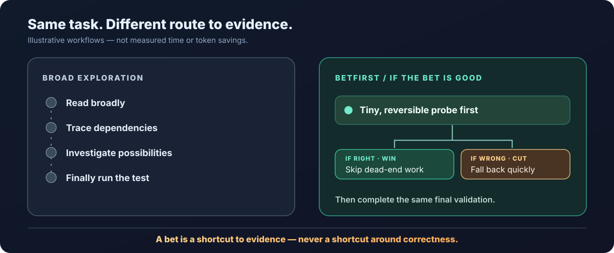
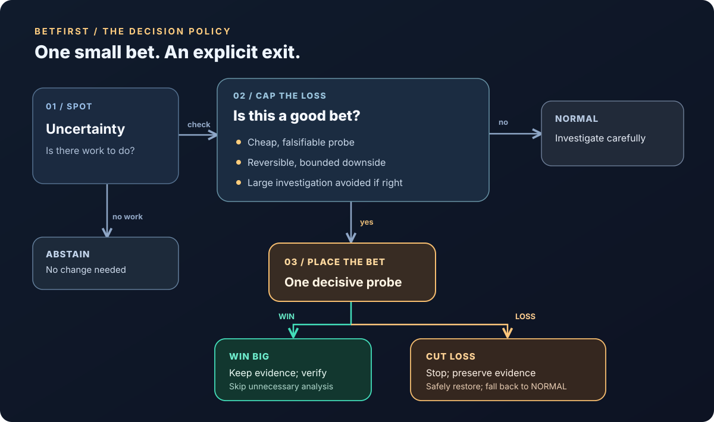

<p align="center"><a href="./README.md">English</a> · <a href="./README.zh-TW.md">繁體中文</a></p>

<p align="center">
  
</p>

# BetFirst

> **What if your coding agent tested the obvious hypothesis before reading another 20 files?**

**Make cheap bets. Win big. Lose small.** BetFirst is a cost-aware execution Skill for coding agents: take a **tiny, falsifiable, reversible bet** when it can eliminate a costly investigation. If it loses, **cut the loss**, preserve evidence, and fall back to normal development.

**Claude Code first · Pi compatible · No additional runtime dependencies**

> [!IMPORTANT]
> **Experimental v0.1.** This is a decision policy, not a measured speedup. **No token, time, or cost savings are claimed yet.** Read the [evaluation protocol](evals/README.md) before drawing performance conclusions.

## Try it in 30 seconds

With the repository's Claude Code plugin installed (instructions below), invoke `/tc3oliver-skills:betfirst`, then give the agent a real coding task.

```text
Use BetFirst for this task. If a cheap, reversible probe can settle
a key uncertainty, take that bet. Stop immediately if it fails or
becomes inconclusive, preserve my existing work, and finish with
the normal correctness checks.
```

**The bet is optional.** If no cheap, decisive, bounded experiment exists, keep working normally.

## Why this exists

Coding agents often pay for broad file reads, dependency tracing and long tool outputs before trying a tiny diagnostic test. Sometimes that investigation is essential. Sometimes a ten-second probe could invalidate the guess first.

**BetFirst targets the second case.** It trades a small, bounded downside for the chance to avoid a much larger investigation.

| BetFirst **is** | BetFirst **is not** |
| --- | --- |
| A decision policy for small, falsifiable probes | A command to guess and ship |
| A way to buy evidence cheaply | Permission to skip required tests |
| A bounded failure with a normal fallback | A replacement for systematic debugging |
| Agent-neutral instructions | A new runtime, daemon, or framework |

<p align="center">
  
</p>

## The behavior

<p align="center">
  
</p>

**SPOT → CAP → BET → WIN / CUT LOSS.** When there is no actual need to change anything, **ABSTAIN**. A bet is an early diagnostic shortcut, **not** a permission to guess the fix.

Typical opportunities: isolate an FFmpeg argument using a tiny file, test a serializer against one synthetic payload, reproduce a CLI failure with a one-command fixture, or check a narrow build hypothesis.

### When NOT to bet

Bad bets: unbounded testing, destructive Git cleanup, overlapping uncommitted work, production mutations, credentials, remote side effects, and experiments without objective signals. These go through normal analysis instead.

If the task is already satisfied, **ABSTAIN** rather than changing code to manufacture an experiment. A good Skill should know when it has nothing useful to add.

## Install and use

BetFirst lives in this repository's existing Skill catalog. Install it once through **either** Claude's plugin mechanism **or** a portable Agent Skills installation; avoid loading two copies of the same Skill.

### Claude Code — plugin (existing repository distribution)

```text
/plugin marketplace add tc3oliver/skills
/plugin install tc3oliver-skills
```

Run `/tc3oliver-skills:betfirst` explicitly, or ask Claude to use BetFirst while implementing a task. The Skill is also eligible for automatic discovery from its description. It does **not** auto-run a separate background agent or add extra hooks.

### Portable installation (Claude Code; also discoverable by Pi)

```bash
npx skills add tc3oliver/skills --skill betfirst -g -a claude-code -y
```

For Pi, ensure the complete `betfirst/` directory containing `SKILL.md` is installed in a skills directory discovered by your Pi version (commonly `~/.pi/agent/skills/betfirst/` or `~/.agents/skills/betfirst/`). Invoke `/skill:betfirst`. The portable Skill has no Claude-specific commands in its body.

**Choose one Claude installation route** (plugin or Agent Skills CLI) to avoid duplicate entries. Pi and Claude load the same portable `SKILL.md`; there is no runtime-specific fork.

### Sample task prompt

```text
Use BetFirst while fixing the FFmpeg subtitle failure.
If a cheap reversible test can eliminate extensive investigation,
take it; if it fails, cut the loss and diagnose normally.
Preserve my existing changes and complete normal final validation.
```

BetFirst is a policy for *how* to explore within a coding task. It is compatible with the existing `diagnosing-bugs` Skill: use BET to find a faster reproducible feedback loop, not to skip that Skill's diagnosis or regression requirements. It never overrides the repository's acceptance criteria or Definition of Done.

## Why could this work?

An agent pays for reasoning, file reads, long tool outputs, tool latency, and repeated tests. More investigation is useful **only when the value of the additional information exceeds its cost**. A bounded, objective probe can buy that information more cheaply than broad exploration.

This is grounded in **rational metareasoning** (the value of computation) and related work on **cost-aware exploration**. A 2026 coding-agent study also documents avoidable tool and workflow costs, including reductions from carefully designed Skills. These findings motivate BetFirst; they do **not** prove that BetFirst itself is faster.

The core expected-saving model for **one** resource is:

```text
E[saved] = p * S - (1 - p) * L - H
break-even p > (L + H) / (S + L)
```

- `p`: measured (not invented) success probability in a comparable task class.
- `S`: resource saved by a successful bet versus normal execution.
- `L`: additional loss on failure, **including safe cleanup and fallback**.
- `H`: overhead of invoking/deciding under the betting policy.

For illustration **only**, if success saves 9 minutes, failure loses 1 minute, and policy overhead is included in those measurements, break-even success probability is **10%**. Time and tokens must be evaluated **separately**; a faster run can still use more tokens or cost more money.

In actual operation the model should **not** fabricate `p`, estimate every action numerically, or spend more tokens calculating whether to bet than the probe would cost. BetFirst uses low-overhead qualitative gating first; calibration can follow from real measurements.

### Relevant sources

- Russell & Wefald, *Principles of Metareasoning* (1991): https://doi.org/10.1016/0004-3702(91)90015-C
- *Calibrate-Then-Act: Cost-Aware Exploration in LLM Agents* (2026): https://arxiv.org/abs/2602.16699
- *Analyzing and Mitigating Cost-Inefficient Behaviors in Coding Agents* (2026): https://arxiv.org/abs/2609.30725
- Matt Pocock, *writing-for-agents* (guidance on compact leading words, context pointers and non-redundant instructions): https://github.com/mattpocock/skills/tree/main/skills/productivity/writing-for-agents

BetFirst's wording and policy are original to this repository; these works are references, not copied Skill implementations.

## When it wins, when it loses

| Example | Outcome | Expected action |
| --- | --- | --- |
| FFmpeg path escaping with tiny fixture | **WIN candidate** | Probe, fix only if evidence is decisive, then test the real renderer |
| TTS resample probe fails to change the artifact | **CUT LOSS** | Stop after the first disproven hypothesis; preserve observation |
| Shared production database needs mutation | **NORMAL** | Never speculate against irreversible state |
| Acceptance criteria already satisfied | **ABSTAIN** | Do not change working code to create a bet |
| Dirty worktree overlaps candidate edit | **NORMAL / read-only probe** | Never destroy user changes |

See [decision examples](references/examples.md) for precise conditions and failure signals.

## Evidence and evaluation

**The Skill is not a telemetry collector.** Routine coding should not pay for extra logging or worktrees. Benchmarking should use independent session telemetry and acceptance tests.

The included [evaluation protocol](evals/README.md), [qualitative cases](evals/cases.json), and stdlib [CSV analyzer](scripts/analyze_runs.py) support:

1. `baseline`: the original agent without BetFirst.
2. `efficiency`: basic concise/no-redundant-work rules.
3. `betfirst`: the same efficiency rules plus the betting decision policy.

Use identical tasks and clean start commits, matched repetitions, independent success checks, and real wall-clock plus token/cache/API-cost measurements. Include failed tasks and all fallback overhead. No invented usage and no success-only cherry-picking.

```bash
python3 -m unittest discover -s betfirst/tests
python3 betfirst/scripts/analyze_runs.py path/to/measured-runs.csv
```

The analyzer reports paired time, gross-token and USD-cost savings, with `null` for incomplete telemetry. It is **not** a benchmark runner and does not claim any results until real run data are provided.

## Roadmap

- **v0.1 (this Skill):** portable policy, bounded failure, qualitative cases, repeatable analysis protocol.
- **v0.2:** collect real Claude Code and Pi task sessions, quantify false/missed bets and fallback overhead, compare against baseline and efficiency control.
- **v1.0:** publish reproducible cross-task results; only add runtime instrumentation or enforcement where measured failures justify it.

## Share and contribute

**Find an unexpectedly expensive coding-agent investigation?** Bring a reproducible task with its original repository state, acceptance tests and actual usage logs. Reports of **false bets**, **missed bets**, and **failed stop-losses** are especially valuable. See [evals/README.md](evals/README.md) for the controlled comparison method.

> **The ambition:** Spend less on uncertainty, not less on correctness.

## License

MIT, under the repository's license.
