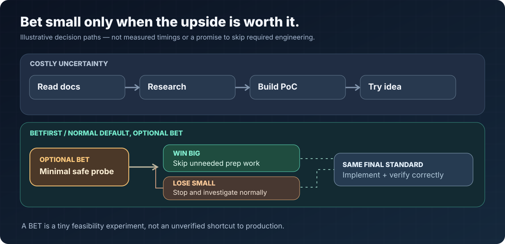

<p align="center"><a href="./README.md">English</a> · <a href="./README.zh-TW.md">繁體中文</a></p>

<p align="center">
  
</p>

<sub>Animated SVG · 126 local runs; paired time comparisons require both arms to PASS. [Full evidence →](../../research/betfirst/experiments/V04_RELEASE_RESULTS.md)</sub>

# BetFirst

### Make Cheap Bets. Win Big. Lose Small.

**Coding agents can spend a lot of time finding out whether an idea will work.** They read documentation, investigate dependencies, compare options, and build a proof of concept—sometimes before trying the smallest thing that could settle the question.

**What if you made one tiny bet *first*?**

BetFirst teaches coding agents to look for a **cheap, falsifiable, reversible bet** before expensive exploration—**only if the bet is worth the cost**. NORMAL is the default; ABSTAIN when no fix is needed. A bet is evidence, never a substitute for correct implementation.

| **WIN BIG** | **LOSE SMALL** | **DON'T FORCE IT** |
| --- | --- | --- |
| One small test answers the question. Skip research or PoC work the result makes unnecessary. | The probe fails or is inconclusive. Stop at the preset limit, keep what you learned, return to normal investigation. | No safe, decisive low-cost test? Don't bet. If the task is already done, don't change anything. |

**Bet on a hypothesis. Never gamble with correctness.** The full fix still needs implementation and final verification.

**Claude Code · Pi · OpenCode · Portable Agent Skill · v0.4 · No additional runtime**

## Try your first bet

Install with the Agent Skills CLI:

```bash
npx skills add tc3oliver/skills --skill betfirst -g -a claude-code -y
```

Then ask your agent:

```text
Use BetFirst. Before spending time on feasibility research or a full
PoC, see if one small, safe, reversible experiment can settle the key
uncertainty. Set a stop condition first. If it works, skip only the
preparation now made unnecessary. If it fails, stop and investigate
normally. Preserve existing work and complete final verification.
```

**Using the Claude Code plugin instead?** Run `/plugin marketplace add tc3oliver/skills`, then `/plugin install tc3oliver-skills`, and invoke `/tc3oliver-skills:betfirst`. Choose **one** installation method.

## Why bet first?

<p align="center">
  
</p>

<sub>Illustrative workflows, **not benchmark measurements**. [Animated concept →](../../media/betfirst/assets/probe-loop.gif)</sub>

A successful bet doesn't magically finish the task. It can make **parts of the preliminary investigation** unnecessary. A failed bet is useful when it cheaply rules out an assumption—and it only stays cheap if the agent actually stops.

### Example: do we really need a full PoC?

*Illustrative scenario, not a recorded benchmark run.*

```text
QUESTION   Can this subtitle filter accept the path format we need?
NORMAL     Read extensive docs, investigate escaping rules,
           assemble a full rendering PoC, then try it.
BET        Use one synthetic path and one tiny filter invocation.
WIN        Confirm the behavior, avoid now-unnecessary feasibility
           investigation, implement the real fix, verify normally.
LOSE       Stop the probe, keep the error as evidence, investigate
           the documentation and implementation as needed.
```

**The bet may itself be a tiny PoC.** The point is to avoid paying for a *large* PoC before checking the one make-or-break assumption.

## The decision rule

**SPOT → CAP → BET → WIN / CUT LOSS**

**SPOT** a costly uncertainty with a cheap decisive signal. **CAP** the cost, timeout and cleanup *before* the experiment. **BET** with one safe, reversible test. **WIN** means evidence lets you skip only work that is no longer necessary. **CUT LOSS** means stop at the limit and use the observation to guide NORMAL debugging.

If the experiment could write production data, expose secrets, disturb someone else's changes, or cannot be safely stopped, **go NORMAL**. If nothing needs changing, **ABSTAIN**.

[Decision flow →](../../media/betfirst/assets/decision-flow.svg) · [Why a small bet can pay off →](./WHY_BETFIRST.md)

## Works with your existing agent

**Claude Code:** Install via the CLI or plugin above. The Skill does not run a second agent or require telemetry.

**Pi:** Install the complete `betfirst/` directory into a Pi-discovered Skill location (for example `~/.pi/agent/skills/betfirst/`) and invoke `/skill:betfirst`. The [portable Skill](../../betfirst/SKILL.md) has no Claude-specific runtime.

**Other compatible agents:** They can use the portable `SKILL.md`; automatic discovery depends on the tool. BetFirst works independently of Backlog and Claude Team Kit.

## Does the bet pay off? The data, including losses

**126 local Muse agent runs**, in two different controlled synthetic-task studies. In the first held-out cohort (54 runs), v0.4 passed **18/18** and averaged **13.53s**, versus **18.22s** for Efficiency and **15.37s** for v0.3. In the follow-up ablation (72 runs), v0.4 passed **23/24**; average wall time was **15.25s**, versus **17.93s** for Efficiency (23/24 PASS) and **19.88s** for No-BET (22/24 PASS). Among 22 pairs where both arms passed, v0.4 showed **17.9% lower wall time vs Efficiency** and **18.0% vs No-BET**. 

**Not every bet wins.** Earlier policies were *slower* on simple tasks. Four follow-up Oracle failures shared an ambiguous uppercase-boolean requirement. These experiments do not establish universal speedups or prove that the BET mechanism independently caused the gains. Token data were incomplete. [Full methodology, unfavorable cases and caveats →](../../research/betfirst/experiments/V04_RELEASE_RESULTS.md) · [History →](../../research/betfirst/experiments/EXPERIMENT_HISTORY.md)

## Ready to try it?

Give BetFirst your next make-or-break feasibility question. See if one small, safe experiment can save a much bigger investigation.

[Explore decision examples →](./examples.md) · [Read the Skill →](../../betfirst/SKILL.md)

**Make Cheap Bets. Win Big. Lose Small.** Spend less finding out *if* something works, without lowering the bar for making it work.

MIT License.
